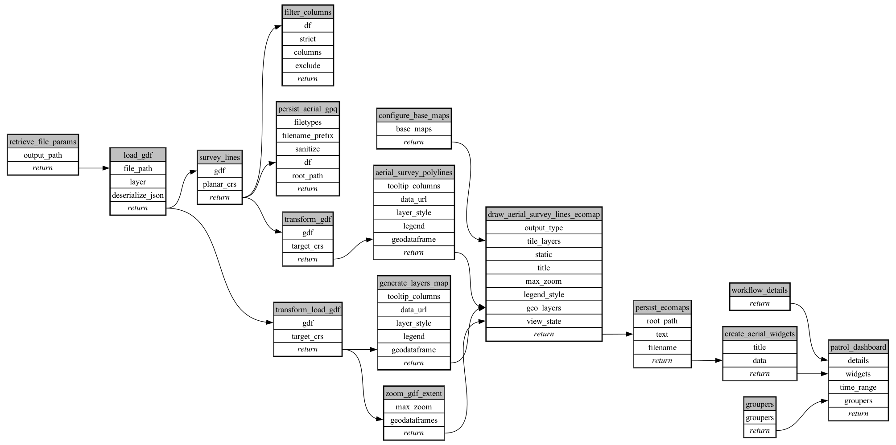

```
# AUTOGENERATED BY ECOSCOPE-WORKFLOWS; see fingerprint in README.md for details

```

```yaml
# fingerprint:
artifacts_sha256_basic: a8de8cbacef851112e391a1bde938b267a72b4225d52582c9108262d8e50a7f7
artifacts_sha256_strict: 4ae2e86233ca48425380e75e50d33a4b8c9a17fb2279ccbfd427d1d4a6cda950
installed_requirements:
- channel: https://repo.prefix.dev/ecoscope-workflows/
  name: ecoscope-platform
  version: {version: ==2.25.3}
- channel: https://repo.prefix.dev/ecoscope-workflows-custom/
  name: ecoscope-workflows-ext-custom
  version: {version: ==0.1.4}
- channel: https://repo.prefix.dev/ecoscope-workflows-custom/
  name: ecoscope-workflows-ext-ste
  version: {version: ==0.0.24}
- channel: conda-forge
  name: pydeck
  version: {version: ==0.9.2}
params_sha256: 6c7df0268dcd2aaadd0db5bdb6850e1c3841183489c88025d4dff977dd7dd861
spec_sha256: 9f45718cf8347ac77543f20ad4ad1b921252c748858b82948b2235626081f15c

```

# ecoscope-workflows-aerial-survey-roi-workflow


